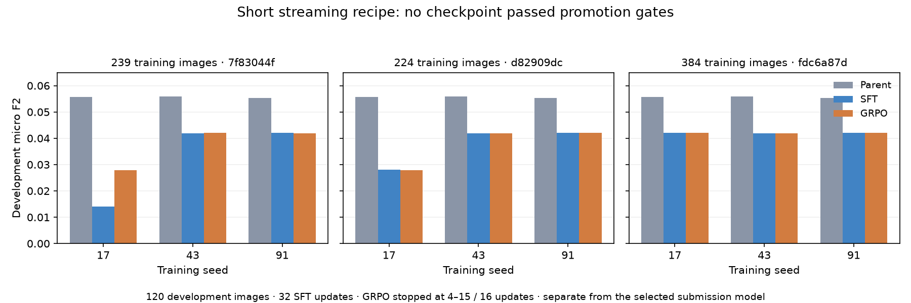

# Continuous execution

Open <http://127.0.0.1:18900/>. Pipeline is the default page. It shows measured
CPU/GPU history, physical reference progress, actual field previews, candidate
examples, immutable batch queues, learning signals and development results.

## Data flow

1. Videos are sampled at five source frames per second. Exact Robotics ER 2
   responses are cached and archived. Confidence >=0.60 retains machine-label
   provenance and does not imply human review.
2. The ingester verifies hashes, recording/zone holdouts and uncertainty. It
   publishes eligible records, reviewed ZIP anchors and train-only backgrounds.
3. Parallel DuMux cases must pass actual numerical admission. Completion alone
   never accepts a field. The first accepted pair can release an auxiliary
   synthetic shard without waiting for all 184 planned trajectories.
4. Native sensor GSD, crop geometry and certificate hashes are retained. A metre
   patch is never stretched into a full scene. Auxiliary crops are capped at 25%
   of a training batch; realistic background hybrids require separate validation.
5. New eligible training arrivals freeze a batch with anchors and replay.
   Held-out arrivals alone cannot trigger training. Seeds 17/43/91 queue
   SFT -> GRPO -> candidate development comparison -> shared parent comparison;
   SFT checkpoints also receive a separate utility comparison.
6. Promotion requires the configured checks. Predictions, checkpoints, failed
   results and reward-variance limitations remain inspectable.

The full 184-trajectory / 30,000-image / three-seed protocol remains separate
and incomplete. Cropped auxiliary evidence does not establish a validated
64 m campaign generator or calibrated realistic full-flight images.

## Resources

The current standard VM has 48 vCPUs and four A100 40 GB GPUs. Its runtime
`system.slice` CPU quota is 4300% (43 cores, approximately 89.6% of the host),
with a 300 GiB memory high-water mark. Telemetry reports actual usage separately
from allocations. High utilization is a scheduling target, not busywork.

The full-BF16 single-GPU forward/backward/GRPO probe passed. Current training
uses exclusive single-GPU groups, microbatch 2 and accumulation 2
(effective batch 4), with measured peak reservation around 25.3 GB per GPU.
Active optimizer work is preserved during controller restarts.

Local dashboard, observer tunnel/mirror and verified input bridge now have
persistent user-service definitions. After a host reboot, confirm the external
SSD is mounted before treating local artifacts as available. A connected observer
does not imply an active solver or optimizer: inspect actual queue and telemetry.

Scheduled shutdown is **2026-11-16 16:46:54 UTC / 18:46:54 Helsinki**.
The standard VM has a 48-hour cloud runtime limit with STOP termination;
the local shutdown timer expires four seconds before that limit. The streaming
controller deadline now matches the local timer. Checkpoints are archived
outside the VM.

## Research resumed after submission preparation

At 2026-11-14 23:07:21 UTC, the submission-priority dispatch pause was lifted
after validating both queued manifests. Six previously queued jobs cover seeds
17, 43 and 91 on two batches (239 and 224 eligible images). At 23:07:26,
the first three workers started on GPUs 1, 2 and 3. GPU 0 remains reserved for
the live inference service. The original 32-step SFT / 16-step GRPO recipe,
dataset admission rules and promotion checks are unchanged. Starting a worker
does not establish that its optimization or evaluation has completed.

`cloud/resume_research_queue.py` refuses to restart a coordinator with active
managed workers or occupied training GPUs. It retains the previous settings,
controls and queue under `pipeline/recovery/postsubmission-resume-*/`, and
records manifest hashes and the corrected cutoff in a receipt. The submission
package and published measurements remain frozen; new work lives on
`codex/research-replication`.

The separate airborne labeling worker is **not running**. Its last completed
batch retained 4,198 labels from 4,242 frames, with 44 failures and no pending
archive uploads. This is partial batch coverage, not completion of all videos.
The older input inventory (2026-11-14 14:44:50 UTC) still reports 59 pending
source versions and 2,335 unresolved frame failures across earlier queues;
those figures are not a fresh unique-request estimate. Existing paid caches
must be reconciled with airborne eligibility before restarting inference.
The full physical protocol described above remains incomplete.

The local NTFS data partition was found unmounted during the follow-up audit.
The normal mount failed with `volume is dirty and "force" flag is not set`.
It is accessible at `/mnt/aerorozum-recovery-readonly` using
`ntfs-3g -o ro,norecover`; no repair or forced writable mount was attempted.
Local write-based ingestion remains unavailable. VM training uses its already
validated input copies independently of this volume.

`cloud/audit_label_coverage.py` joins compact saved-result indexes with the
frozen corrected airborne audit using pixel hash and source generation.
It distinguishes valid retained labels, invalid paid responses and genuinely
missing results. Repeated frames do not count as distinct inference requests,
and an old discovery queue is reconciled against processed source versions.
It makes no API requests and never modifies source trees.

The 23:11 UTC reconciliation read 26,682 saved result records across the
read-only local cache and the VM export. All 12,519 eligible frames in the
183-source frozen audit have a retained paid result: 12,467 frames have valid
labels and 52 have invalid paid responses. Deduplication gives 12,399 unique
identities, including 12,347 valid and 52 invalid. These invalid results are
not negative labels. The later 18:27 UTC discovery snapshot lists 70 pending
versions, but 33 are already represented in the frozen audit; 37 fall outside
it and require sampling and flight-state qualification. See
[the saved reconciliation](evidence/postsubmission-label-coverage.json).

## Follow-up qualification and short-recipe results

A fresh bucket listing at 23:33 UTC still contained 220 normal thermal videos.
The 37 source versions outside the original 183-source audit are being
prepared on the VM by `aerorozum-followup-preparation-v2.service`, with four
workers and the unchanged five-frame-per-second sampling rule. Every admitted
frame requires a one-to-one original receipt clock and fresh autopilot state.
The first attempt found a missing host decoder before qualification; its
reports are retained under `airborne-followup-v1/attempts/missing-host-ffprobe`.
After installing the host decoder, the separate source revision adds a
dependency preflight and reuses the already verified downloads. It makes no
model requests. The [deployment receipt](evidence/followup-preparation-v2.json)
binds its source hash. At 23:35:50 UTC, 18 of 37 sources were processed,
yielding 978 eligible airborne frames with no source quarantines so far.

Nine resumed/arrival-triggered short streaming trials have completed across
three batches and seeds 17/43/91. All ran 32 SFT updates; GRPO stopped at
4–15 updates after the reward-variance guard fired. The saved independent
SFT comparisons show that **none passed the promotion gates**. Their GRPO
development F2 scores are about 0.028–0.042, below their direct-parent scores
of about 0.055–0.056. They do not establish useful RL improvement. These
short-recipe trials are separate from the much stronger selected visual
submission model and do not change its frozen results or the live endpoint.



The [nine-run measurement snapshot](evidence/continuous-research-after-resume.json)
retains actual update counts, manifest hashes, provenance, result hashes and
checkpoint selection decisions. Further model work should compare the
already established longer visual recipe across seeds, while preserving the
opened test set from further selection. The full physical study remains
incomplete.

At 23:37:57 UTC the follow-up preparation finished all 37 source versions,
with 2,294 eligible airborne frames and no source quarantines. The frozen ER2
worker validated every staged pixel and audit hash before resuming at
23:39:47 UTC. Its prompt remains `thermal-v2-recall-calibrated` with SHA-256
`b6e271c2bdb530264b9844ed87822bfe82cb31763568db8efa4dbca9ab0d94ad`.
The [launch receipt](evidence/followup-label-launch.json) binds the 26,682-record
combined paid-cache index and the source qualification audit. All 2,294 frames
were absent from that prior paid index. At the first live check, 90 frames
had completed with zero failures and 90 canonical uploads, with no uploads
pending. This is an active batch, not a claim of completed labeling.

`cloud/stage_followup_label_plan.py` stages exact bytes, preserves the old
launch plan, and refuses to change the plan of a live label worker. Its
pending-only selection excludes invalid retained paid responses as well as
valid prior labels; an invalid answer never becomes a negative label. The
existing worker's code, 120 RPM / 500,000 input TPM limits, separate hackathon
key, and original-response archive remain unchanged.

## Inspect execution

VM services include `aerorozum-stream-pipeline.service`, physical workers and
uploaders, and `aerorozum-research-observer.service`. The observer binds only to
VM loopback port 18920. A private SSH forward and local mirror carry measured
state and published previews to the dashboard; no public telemetry port is open.

Under the artifact root:

- `pipeline/worker.json`: mirrored physical/controller progress.
- `pipeline/telemetry.json`: utilization, RAM and disk measurements.
- `pipeline/inputs/real.json`: complete verified input index; browser gets counts.
- `pipeline/inputs/backgrounds.json`: screened train-only recorded textures.
- `pipeline/media/`: published physical and training previews.
- `cloud/health.json`: unresolved issues, including boot-2 PCR7 baseline mismatch.
- `cloud/20h-extension-verification.json`: actual scheduling readback.

Local services can be inspected with:

```sh
systemctl --user status aerorozum-research-api.service
systemctl --user status aerorozum-research-observer-tunnel.service
systemctl --user status aerorozum-research-observer-mirror.service
systemctl --user status aerorozum-real-data-ingester.service
systemctl --user status aerorozum-label-cache-recovery.service
```

The API has bounded graceful shutdown so event streams cannot indefinitely
stall updates. Opening Pipeline does not start paid calls or provision machines.
See [paid-label-archive.md](paid-label-archive.md), [gpu-physics.md](gpu-physics.md)
and [presentation/journal.md](presentation/journal.md) for receipts and screenshots.
