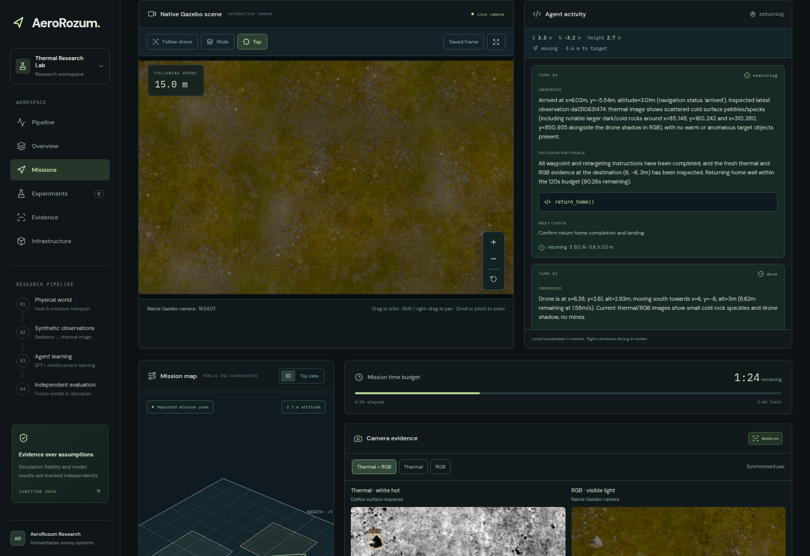
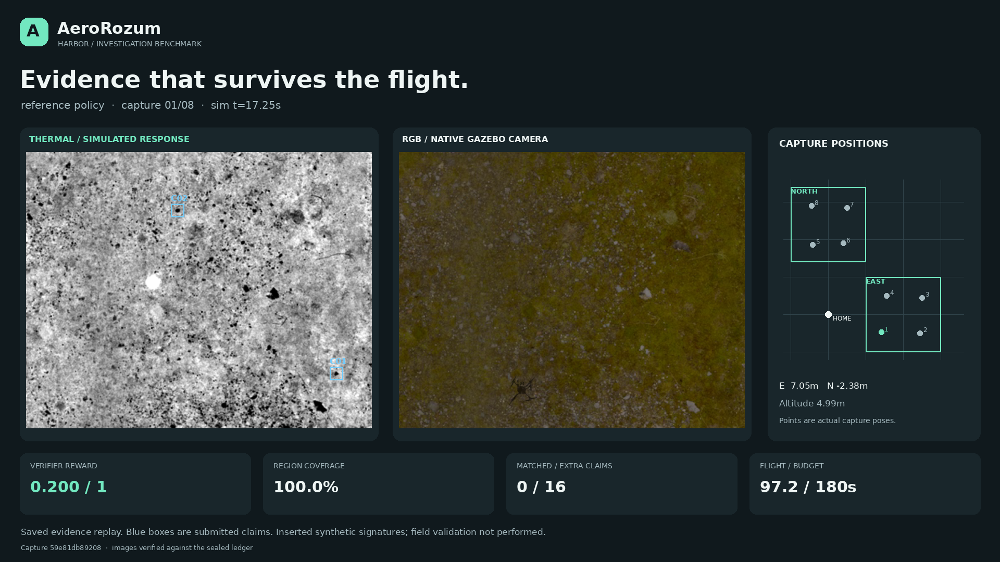
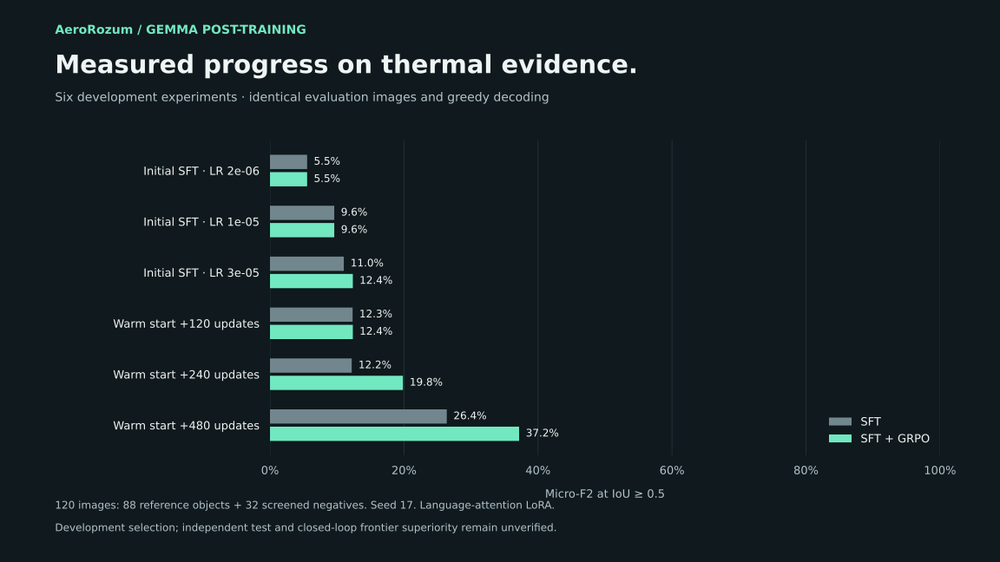
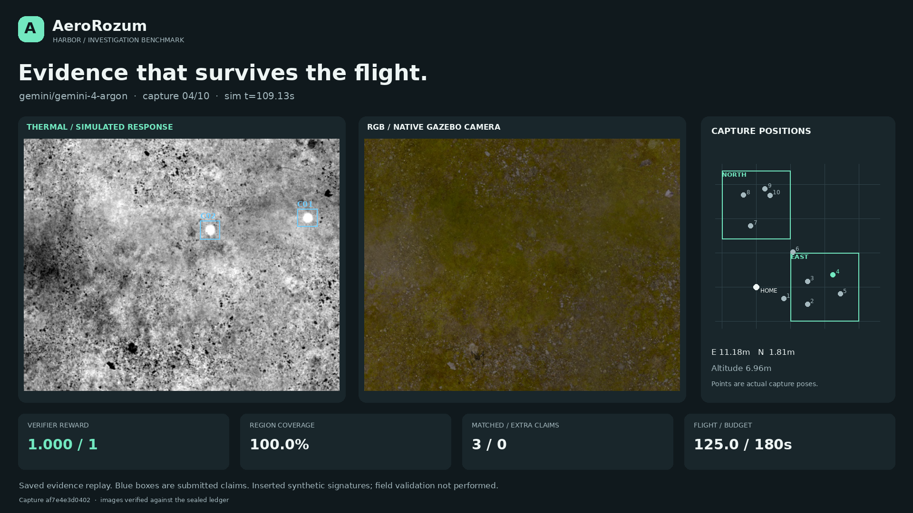
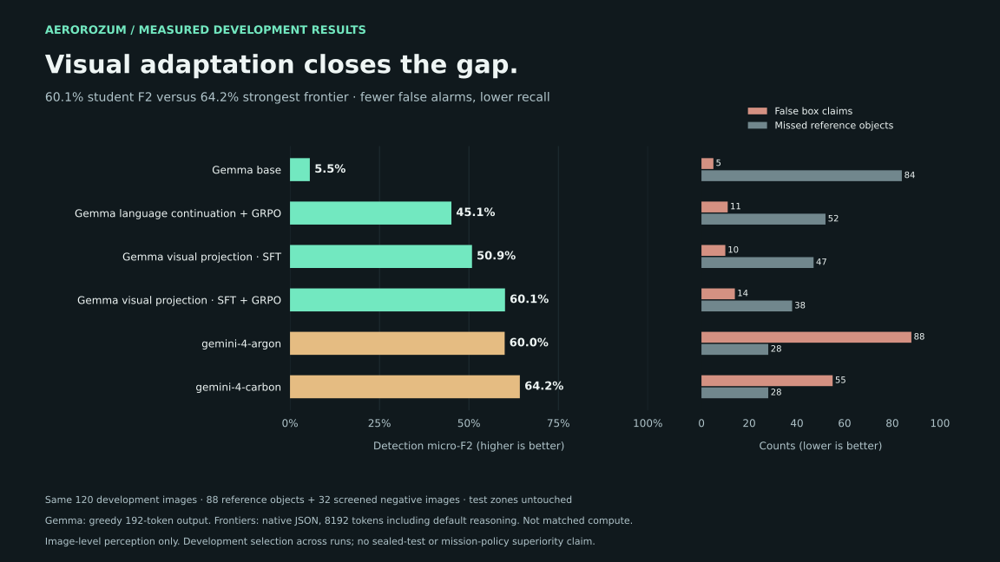

# Presentation assets

The center image is captured together with native RGB. The right image is
rendered from the cooling snapshot at the exact same camera pose. The caption
distinguishes captured and rendered comparison evidence.

See [camera implementation and limitations](../paired-physics-camera.md).

The overview now has a native camera rig: close follow, world overview,
top-down, drag orbit, Shift/right-drag pan, scroll/pinch zoom and fullscreen.
The screenshot is an actual Gazebo render during a reference-controller flight.
Saved images use clearly labelled image zoom. Camera movement runs separately
from aircraft control; paired RGB/thermal evidence still comes from the drone.

Large videos, original flight evidence, API logs and datasets remain in the
private SSD/GCS artifact store and are deliberately excluded from Git.

The agent sends arbitrary local `goto(x, y, altitude)` commands and reviews
synchronized thermal/RGB evidence while the drone keeps flying. The activity
panel records concise observations, operational rationales, tool calls and
actual navigation feedback. Native mission `24859da319234e7d` redirected from
`(22,22,4)` to `(6,-6,3)` before reaching the first target, then observed and
requested return. This verifies the tool loop; it does not establish mine
detection accuracy or RL improvement. See [implementation and validation](../coordinate-flight-agent.md).

[Live mission and saved feedback](https://136.115.179.240/?mission=24859da319234e7d)
and [recorded coordinate-tool demonstration](https://136.115.179.240/artifacts/presentation/coordinate-agent-tools.mp4).

This is an actual saved Harbor reference playthrough, score **0.20/1**. Blue
boxes show that policy's submitted claims; all 16 were false positives. It
covered the regions and returned home but missed the three inserted thermal
signatures. This is a development failure-analysis asset, not a successful
detector demonstration. The thermal view is a composed simulated response on
recorded terrain appearance; RGB is a native Gazebo render. Image hashes are
checked against the sealed evidence ledger before rendering.

[Evidence replay video](https://136.115.179.240/artifacts/presentation/harbor-reference-v3/harbor-evidence-replay.mp4)
uses chronological captured pairs, two seconds each. It does not interpolate
unobserved viewpoints or claim to be a continuous flight recording.
[Replay provenance](https://136.115.179.240/presentation/harbor-reference-v3/provenance.json)
records the original ledger hash and image identities.

Six completed training arms share the same 120-image development set and seed.
The longest warm-start arm improved from 26.4% SFT F2 to 37.2% after GRPO.
This is perception development selection; a native mission-policy or
frontier-superiority result has not been established.
[Slide PNG](https://136.115.179.240/artifacts/presentation/refinement-results.png)
and [source measurements](../evidence/measured-refinements.json).

Gemini Argon's actual development mission scored **1.0**: three matched
insertions, zero false claims, full coverage and independent views. Its agent
process subsequently exited with an OpenCode Git snapshot EPIPE error; retain
that warning beside the successful mission score. Later runs initialize an
agent-owned Git workspace and exit cleanly. This warm scenario did not break
the frontier model and does not show a student-model win.

[Captured-pair replay](https://136.115.179.240/artifacts/presentation/harbor-gemini-v3/harbor-evidence-replay.mp4)
and [hash provenance](https://136.115.179.240/presentation/harbor-gemini-v3/provenance.json).
The replay consists of chronological saved pairs, two seconds each.

The newer visual-projection model reached **60.1% development F2**, versus its
50.9% SFT control and the strongest frontier's 64.2%. It made 14 false box
claims versus the frontier's 55, while missing more reference objects (38 vs
28). These are image-level development results, distinct from mission rewards.
[Latest measurements and protocol differences](../evidence/submission-measurements-latest.json).

[Slide PNG](https://136.115.179.240/artifacts/presentation/development-comparison.png).
The count panel keeps missed objects visible alongside false claims; the
student's lower false-alarm count is not described as higher overall F2.

## Submission presentation

[Six-slide deck](https://136.115.179.240/presentation/submission/deck.html)
and [result/evidence page](https://136.115.179.240/presentation/submission/index.html)
use actual saved images and completed measurement snapshots. Source HTML is
versioned under `docs/presentation/submission/`; PDF and video exports are
served with the public artifacts.

The new close-inspection reference earned 0.733 on each of two fresh instances,
landing at 71.484 and 73.104 simulated seconds within a 75-second budget. The
visual Gemma agent captured three observations but stopped without landing or
submitting a report: reward zero, clean process exit. No-op, early-stop,
reward-file spoof, forged evidence/local-image mutation and private-state probes
all earned zero. The original camera bytes survived local image mutation;
private files were absent and the pre-seal ledger endpoint returned 404.

[New task reference replay](https://136.115.179.240/artifacts/presentation/harbor-budgeted-reference/harbor-evidence-replay.mp4)
and [clean baseline Carbon replay](https://136.115.179.240/artifacts/presentation/harbor-clean-carbon/harbor-evidence-replay.mp4)
are chronological saved pairs, two seconds each. Their task rules differ;
rewards are not a before/after comparison. The first short-cap Gemini attempts
that stopped before takeoff are explicitly labelled; larger-allowance retries
retain the same environment and are recorded separately.
