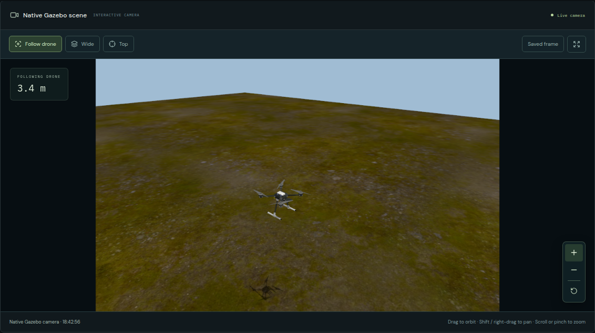

# Presentation assets

The center image is captured together with native RGB. The right image is
rendered from the cooling snapshot at the exact same camera pose. The caption
distinguishes captured and rendered comparison evidence.

See [camera implementation and limitations](../paired-physics-camera.md).

The overview now has a native camera rig: close follow, world overview,
top-down, drag orbit, Shift/right-drag pan, scroll/pinch zoom and fullscreen.
The screenshot is an actual Gazebo render during a reference-controller flight.
Saved images use clearly labelled image zoom. Camera movement runs separately
from aircraft control; paired RGB/thermal evidence still comes from the drone.

Large videos, original flight evidence, API logs and datasets remain in the
private SSD/GCS artifact store and are deliberately excluded from Git.

The agent sends arbitrary local `goto(x, y, altitude)` commands and reviews
synchronized thermal/RGB evidence while the drone keeps flying. The activity
panel records concise observations, operational rationales, tool calls and
actual navigation feedback. Native mission `24859da319234e7d` redirected from
`(22,22,4)` to `(6,-6,3)` before reaching the first target, then observed and
requested return. This verifies the tool loop; it does not establish mine
detection accuracy or RL improvement. See [implementation and validation](../coordinate-flight-agent.md).

[Live mission and saved feedback](https://136.115.179.240/?mission=24859da319234e7d)
and [recorded coordinate-tool demonstration](https://136.115.179.240/artifacts/presentation/coordinate-agent-tools.mp4).
