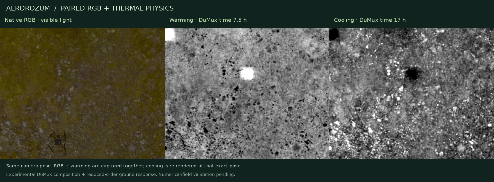

# Presentation assets

The center image is captured together with native RGB. The right image is
rendered from the cooling snapshot at the exact same camera pose. The caption
distinguishes captured and rendered comparison evidence.

See [camera implementation and limitations](../paired-physics-camera.md).
Large videos, original flight evidence, API logs and datasets remain in the
private SSD/GCS artifact store and are deliberately excluded from Git.
